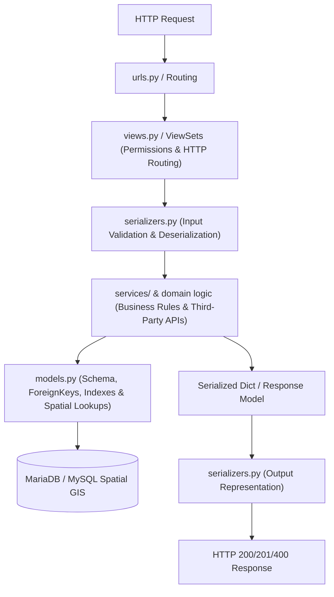

# Backend Agent Rules & Architecture Guide (rendbd_backend/AGENTS.md)

> **Scope:** `RentBD/rendbd_backend/`  
> **Framework:** Django 5.x & Django REST Framework (DRF)  
> **Database:** MariaDB / MySQL 10.4+ Spatial GIS (SQLite fallback for unit testing via `USE_SQLITE=True`)  
> **Python Version:** Python 3.10+  

---

## 1. Clean Service-Layer Architecture

All backend engineering must adhere to a strict separation of concerns following the Service-Layer pattern. Business logic must never bleed into views or serializers.



### 1.1 Layer Responsibilities & Guardrails

| Layer | Primary Responsibility | Strict Rules |
| :--- | :--- | :--- |
| **Models (`models.py`)** | Database schemas, table relations, constraints, custom querysets. | 1. No external HTTP calls or complex business rules.<br>2. Every `ForeignKey` must specify an explicit, semantic `related_name`.<br>3. Frequently filtered columns (`district`, `status`, `tenant_type`, `rent`) must have `db_index=True`. |
| **Serializers (`serializers.py`)** | Field validation, data coercion, serialization/deserialization. | 1. Validation logic only in `validate_<field>()` or `validate()`.<br>2. Never call third-party payment gateways or SMS APIs inside serializers. |
| **Services (`services.py` / App Services)**| Core business logic, pricing computations, Agora token generation, SMS dispatch. | 1. Stateless functions or service classes.<br>2. Catch third-party network exceptions gracefully.<br>3. Handle database transactions (`@transaction.atomic`) when mutating multiple models. |
| **Views / ViewSets (`views.py`)** | HTTP request parsing, permission gating, routing to services. | 1. Keep views thin ($< 35$ lines per handler).<br>2. Decorate with drf-spectacular `@extend_schema` for OpenAPI documentation.<br>3. Return standardized HTTP status codes. |

---

## 2. Database & Spatial Query Guidelines

### 2.1 MariaDB / MySQL Spatial GIS Operations
For production geospatial searches (Dhaka, Chittagong, Sylhet), rely on Spatial GIS extensions:
- **Freehand Custom Polygon:** Use `ST_Contains(ST_GeomFromText(polygon_wkt), point)` to isolate properties within arbitrary boundaries.
- **Radial Distance & 500m Walkability:** Use `ST_Distance_Sphere(point1, point2)` for sub-second distance calculations.
- **Test Compatibility Fallback:** Unit tests run with `USE_SQLITE=True` using the in-memory ray-casting algorithm (`is_point_in_polygon`), ensuring zero external dependencies during automated test execution.

```python
# Production Spatial GIS Pattern
from django.db import connection

def filter_properties_within_polygon(polygon_wkt: str):
    """
    Executes MySQL ST_Contains spatial query across indexed 2D Point geometries.
    """
    raw_query = """
        SELECT id FROM properties_property
        WHERE ST_Contains(ST_GeomFromText(%s), POINT(longitude, latitude))
          AND status = 'available'
    """
    with connection.cursor() as cursor:
        cursor.execute(raw_query, [polygon_wkt])
        ids = [row[0] for row in cursor.fetchall()]
    return Property.objects.filter(id__in=ids)
```

### 2.2 ForeignKey & Indexing Rules
- **Explicit `related_name`:** Mandatory on all relationships (e.g., `landlord = models.ForeignKey(User, on_delete=models.CASCADE, related_name='properties')`).
- **Composite Indexes:** For high-throughput search filtering, apply composite indexes in `class Meta`:
  ```python
  class Meta:
      indexes = [
          models.Index(fields=['status', 'tenant_type', 'monthly_rent']),
          models.Index(fields=['district', 'thana']),
      ]
  ```

---

## 3. Security, Permissions & Validation Standards

### 3.1 Role-Based Permissions
Custom permission classes enforce strict role boundaries (`tenant`, `landlord`, `dual`, `admin`):
```python
from rest_framework.permissions import BasePermission

class IsTenantUser(BasePermission):
    def has_permission(self, request, view):
        return bool(request.user and request.user.is_authenticated and 
                    request.user.role in ['tenant', 'dual'])

class IsLandlordUser(BasePermission):
    def has_permission(self, request, view):
        return bool(request.user and request.user.is_authenticated and 
                    request.user.role in ['landlord', 'dual'])

class IsAdminUser(BasePermission):
    def has_permission(self, request, view):
        return bool(request.user and request.user.is_authenticated and 
                    (request.user.is_staff or getattr(request.user, 'role', '') == 'admin'))
```

### 3.2 Bangladesh Mobile Number Validation
All phone number inputs must be validated against the standard Bangladeshi mobile telecommunications format (`+8801[3-9]\d{8}`):
```python
import re
from rest_framework.exceptions import ValidationError

BD_PHONE_REGEX = re.compile(r'^(?:\+8801|01)[3-9]\d{8}$')

def validate_bangladesh_phone(value: str) -> str:
    cleaned = value.strip().replace(" ", "").replace("-", "")
    if not BD_PHONE_REGEX.match(cleaned):
        raise ValidationError("Please provide a valid Bangladeshi mobile number (e.g. +8801712345678).")
    if cleaned.startswith("01"):
        cleaned = "+88" + cleaned
    return cleaned
```

### 3.3 Safe EXIF Metadata Parsing
The photo verification service must inspect image binary EXIF tags safely without crashing when EXIF headers are absent:
```python
from PIL import Image, ExifTags

def extract_exif_gps(image_file):
    """
    Extracts GPS coordinates from an in-memory image upload safely.
    Returns (latitude, longitude) or (None, None).
    """
    try:
        image = Image.open(image_file)
        exif = image._getexif()
        if not exif:
            return None, None
        
        gps_info = {}
        for key, value in exif.items():
            decoded = ExifTags.TAGS.get(key, key)
            if decoded == "GPSInfo":
                gps_info = value
                break
        
        if not gps_info:
            return None, None
            
        # Parse GPS coordinates safely...
        return lat, lon
    except Exception:
        # Never crash on malformed or non-JPEG uploads
        return None, None
```

---

## 4. Testing & Verification Gate Protocol

Backend agents must execute local tests prior to concluding any engineering task:

```bash
cd rendbd_backend

# 1. System integrity & migration sanity check
python manage.py check

# 2. Run test suite using SQLite in-memory runner
USE_SQLITE=True ./venv/bin/python manage.py test apps.accounts apps.properties apps.inquiries apps.insights apps.ledger apps.chat apps.admin_ops
```

### Quality Acceptance Criteria:
- **Exit Code:** `0`
- **Minimum Test Count:** 62 tests passing (encompassing all 44 core tests + 18 admin operations tests).
- **Zero Warnings:** No deprecation warnings or unhandled exceptions.
