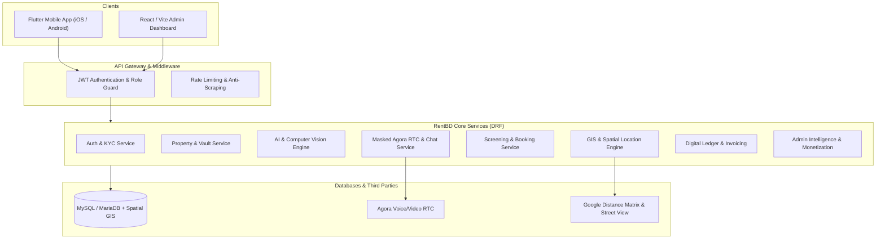

# RentBD Platform Features & API Specification Guide

> **Document Type:** Master Feature & API Specification Manual  
> **Target Audience:** Frontend Engineers (Flutter Mobile), Web Engineers (React/Vite Admin), Backend Engineers (Django REST Framework), QA Engineers & Product Managers  
> **Platform Version:** RentBD v1.0.0 (Production Architecture)  
> **Database:** MariaDB / MySQL 10.4+ with Spatial GIS Geometry  
> **Authentication:** JWT Bearer Tokens (HS256) with Role-Based Access Control (`tenant`, `landlord`, `dual`, `admin`)

---

## 📑 Executive Summary

RentBD is an end-to-end rental housing ecosystem engineered specifically for the urban Bangladesh rental market (Dhaka, Chittagong, Sylhet, and beyond). It bridges the trust and information asymmetry gap between tenants and landlords through:
1. **Verified Identities & Anti-Broker Guards:** NID verification and live selfie checks eliminate unauthorized middlemen.
2. **AI-Powered Exploration:** Multilingual natural language search (Bangla, Banglish, English), Fair Rent pricing intelligence, automated listing copywriting, and photo classification.
3. **Location Intelligence:** Interactive freehand polygon map search, 500m walkability amenity layers, peak-hour commute calculations via Google Distance Matrix, and access road width checks.
4. **Frictionless Property Management:** 60-second mobile listing, a persistent Property Vault for 1-tap re-listing, tenant screening inboxes with verified profiles, and automated 15-day availability checks.
5. **Trust, Safety & Privacy:** Masked VoIP audio/video calling via Agora RTC, end-to-end in-app chat, and EXIF GPS-validated live photo verification.
6. **Financial Transparency:** Complete digital rent ledger, automated bKash/Nagad bill settlement, automated SMS/push reminders, and downloadable legal rent receipts.

This document maps **every functional feature** to its corresponding **backend REST API endpoint(s)**, detailing the business problem solved, the actor personas, request parameters, response models, and client implementation workflows.

---

## 🏗️ Architecture & Interaction Flow



---

## 📋 Comprehensive Feature Breakdown

```
========================================================================================
FEATURE CATALOG INDEX
========================================================================================
1. TENANT EXPERIENCE & SEARCH FEATURES
   1.1 Smart Onboarding & OTP-Based Login
   1.2 Verified Tenant Profile & KYC Credentials
   1.3 Bachelor / Family / Sublet Dedicated Switch
   1.4 Side-by-Side Property Comparison Matrix
   1.5 Visit Scheduler & Live Video Walkthrough
   1.6 Saved Searches & Real-Time Push Alerts
   1.7 Move-in Upfront Cost Calculator
   1.8 Shortlist & Saved Favorites

2. AI-POWERED RENTAL DIFFERENTIATORS
   2.1 Multilingual Natural Language & Voice Search (Bangla / Banglish)
   2.2 AI Fair Rent Meter (Dynamic Neighborhood Pricing Gauge)
   2.3 AI Photo Classifier & Quality Enhancer
   2.4 One-Click AI Property Listing Copywriter
   2.5 AI Legal Rent Agreement (Chuktinama) Generator

3. GOOGLE MAPS & LOCATION INTELLIGENCE
   3.1 Draw-on-Map Freehand Spatial Polygon Search
   3.2 Office / University Commute & Traffic Delay Calculator
   3.3 Nearby Essentials Layer (500m Walkability Score)
   3.4 Street View & Alley Width Accessibility Preview
   3.5 Crowdsourced Area Insights (Waterlogging, Gas, Water & Night Safety)

4. LANDLORD PROPERTY MANAGEMENT & VAULT
   4.1 60-Second Quick Property Publishing Flow
   4.2 1-Tap Re-Listing via Property Vault (Mark as Rented)
   4.3 Tenant Screening Inbox & Verified KYC Dossiers
   4.4 Direct Inquiries Lifecycle Management

5. TRUST, SAFETY & IN-APP COMMUNICATION
   5.1 In-App Masked VoIP Audio/Video Calling (Agora RTC Engine)
   5.2 Real-time Encrypted In-App Chat Rooms & Messages
   5.3 Geo-Tagged Live Photo EXIF Bounding Box Verification
   5.4 Anti-Broker & Landlord Ownership Document Verification
   5.5 15-Day Automated Listing Expiry & Availability Daemon

6. FINANCIAL LEDGER, DIGITAL RECEIPTS & BILLING
   6.1 Monthly Rent & Utility Bill Invoicing
   6.2 Digital Bill Payment Settlement (bKash, Nagad, Bank, Cash)
   6.3 Automated Overdue Payment Reminders
   6.4 Digital Legal Rent Receipts & Tax Records

7. ADMIN INTELLIGENCE & MONETIZATION
   7.1 AI Spam & Duplicate Listing Detector
   7.2 Demand vs. Supply Neighborhood Analytics Heatmap
   7.3 Featured Listing Boosts & Sponsored Placement
   7.4 Affiliate Services (Packers & Movers, Deep Cleaning, Painting)

8. ACCOUNT MANAGEMENT & SECURITY ENGINE
   8.1 JWT Session Renewal & Blacklist Logout
   8.2 Password Lifecycle & OTP-Driven Recovery
   8.3 Seamless Tenant/Landlord Role Switching
========================================================================================
```

---

## 1. Tenant Experience & Search Features

### 1.1 Smart Onboarding & OTP-Based Login
* **Business Problem:** In Bangladesh, passwords are often forgotten, and SMS OTP is the standard for fast, high-trust authentication.
* **Target Roles:** `tenant`, `landlord`, `dual`
* **APIs Used:**
  * `POST /api/v1/auth/otp/request/`
  * `POST /api/v1/auth/otp/verify/`
* **Workflow:**
  1. User enters their Bangladeshi mobile number (`+8801XXXXXXXXX` or `01XXXXXXXXX`).
  2. Mobile client triggers `otp/request/`. DRF generates a cryptographically secure 6-digit code, cached in memory/database with a 5-minute TTL.
  3. User enters the received 6-digit PIN. Client posts to `otp/verify/`.
  4. DRF returns user details, active profile status, and JWT tokens (`access` and `refresh`).
* **Request Sample (`otp/request/`):**
  ```json
  { "phone_number": "+8801712345678" }
  ```
* **Response Sample (`otp/verify/`):**
  ```json
  {
    "success": true,
    "user": {
      "id": "c1f7b9e0-...",
      "phone_number": "+8801712345678",
      "full_name": "Rahim Ahmed",
      "role": "tenant",
      "is_nid_verified": true
    },
    "tokens": {
      "access": "eyJhbGciOi...",
      "refresh": "eyJhbGciOi..."
    }
  }
  ```

---

### 1.2 Verified Tenant Profile & KYC Credentials
* **Business Problem:** Landlords reject prospective tenants due to lack of verified occupational and family credentials. Building instant credibility accelerates renting.
* **Target Roles:** `tenant`, `dual`
* **APIs Used:**
  * `GET /api/v1/auth/profile/`
  * `PATCH /api/v1/auth/profile/update/`
  * `POST /api/v1/auth/nid-verify/` (Alias: `POST /api/v1/auth/kyc/submit/`)
  * `GET /api/v1/auth/nid-status/`
* **Workflow:**
  1. Tenant views their profile card via `GET /api/v1/auth/profile/`.
  2. Tenant updates occupation (`Software Engineer`), workplace/company (`Brain Station 23`), university, emergency contact, and family member count via `PATCH /api/v1/auth/profile/update/`.
  3. Tenant uploads high-resolution front and back photos of their Government NID card + a live selfie to `POST /api/v1/auth/nid-verify/`.
  4. Backend marks the profile with a blue "Verified Tenant" badge once approved.
* **Update Request Sample:**
  ```json
  {
    "full_name": "Rahim Ahmed",
    "occupation": "Software Engineer",
    "workplace": "Brain Station 23, Mohakhali",
    "family_members_count": 3,
    "bio": "Quiet professional family looking for a 3-bedroom flat near Gulshan."
  }
  ```

---

### 1.3 Bachelor / Family / Sublet Dedicated Switch
* **Business Problem:** In Dhaka, many apartment buildings strictly prohibit bachelors or only allow families. RentBD eliminates wasted calls through a single-tap toggle.
* **Target Roles:** `tenant`, `dual` (Public search)
* **APIs Used:**
  * `GET /api/v1/properties/?tenant_type=bachelor`
  * `GET /api/v1/properties/?tenant_type=family`
  * `GET /api/v1/properties/?tenant_type=sublet`
  * `GET /api/v1/properties/?tenant_type=female_student`
* **Workflow:**
  1. The Flutter home screen features a persistent filter bar with dedicated segments: **All**, **Family**, **Bachelor**, **Sublet**, **Female Only**.
  2. Tapping a tab instantly issues a query with the respective `tenant_type` query parameter.
  3. Returns only vetted listings whose landlords have explicitly set matching permissions.
* **Response Sample:**
  ```json
  {
    "count": 42,
    "results": [
      {
        "id": "89b78e24-...",
        "title": "Modern 2-Bed Flat for Bachelors/Students",
        "tenant_type": "bachelor",
        "monthly_rent": "18000.00",
        "area": "Mirpur 2",
        "city": "Dhaka"
      }
    ]
  }
  ```

---

### 1.4 Side-by-Side Property Comparison Matrix
* **Business Problem:** Tenants juggle multiple browser tabs or screenshots to decide between 2–3 flats. A structured side-by-side matrix simplifies final selection.
* **Target Roles:** `tenant`, `dual`
* **APIs Used:**
  * `POST /api/v1/properties/compare/`
* **Workflow:**
  1. Tenant taps the "Compare" checkbox on up to 3 shortlisted properties.
  2. App submits an array of 2 to 3 property UUIDs to `/api/v1/properties/compare/`.
  3. Backend compiles a comprehensive matrix aligning rent, service charges, advance deposit, floor number, square footage, lift/generator backup, and commute distance.
* **Request Sample:**
  ```json
  {
    "property_ids": [
      "97098e5e-653e-46cb-b80c-fc7ef68ec04a",
      "512a80ce-1111-46ab-8888-fc7ef68ec01b"
    ]
  }
  ```
* **Response Sample:**
  ```json
  {
    "count": 2,
    "comparison": [
      {
        "id": "97098e5e-...",
        "title": "Apartment in Bashundhara R/A",
        "monthly_rent": 28000,
        "service_charge": 4500,
        "advance_deposit": 56000,
        "bedrooms": 3,
        "bathrooms": 3,
        "square_feet": 1450,
        "floor": 4,
        "parking": true,
        "lift": true,
        "generator_backup": true
      },
      {
        "id": "512a80ce-...",
        "title": "Cozy Flat in Mirpur DOHS",
        "monthly_rent": 25000,
        "service_charge": 3500,
        "advance_deposit": 50000,
        "bedrooms": 3,
        "bathrooms": 2,
        "square_feet": 1300,
        "floor": 2,
        "parking": false,
        "lift": true,
        "generator_backup": true
      }
    ]
  }
  ```

---

### 1.5 Visit Scheduler & Live Video Walkthrough
* **Business Problem:** Unscheduled drop-ins disturb landlords; traffic in Dhaka makes physical visits time-consuming. Video tours and scheduled slots solve both issues.
* **Target Roles:** `tenant`, `landlord`
* **APIs Used:**
  * `POST /api/v1/inquiries/visit-slots/book/`
  * `GET /api/v1/inquiries/visit-slots/`
  * `PATCH /api/v1/inquiries/visit-slots/{id}/status/`
* **Workflow:**
  1. Tenant selects a property, chooses between `in_person` or `video_call`, and picks a date/time.
  2. System creates a `VisitSlot` reservation in `pending` status.
  3. Landlord receives a push notification, views the request in their calendar, and can `accept`, `reschedule`, or `cancel` the visit.
  4. If `video_call` is accepted, the system unlocks the Agora video channel at the scheduled time.
* **Booking Request Sample:**
  ```json
  {
    "property_id": "97098e5e-...",
    "visit_type": "video_call",
    "scheduled_date": "2026-10-25",
    "scheduled_time": "16:30:00",
    "notes": "Interested in viewing the kitchen ventilation and master bathroom."
  }
  ```

---

### 1.6 Saved Searches & Real-Time Push Alerts
* **Business Problem:** Prime properties are rented within hours. Tenants need instant notifications the moment a listing matches their specific criteria.
* **Target Roles:** `tenant`, `dual`
* **APIs Used:**
  * `GET /api/v1/properties/saved-searches/`
  * `POST /api/v1/properties/saved-searches/`
  * `DELETE /api/v1/properties/saved-searches/{id}/`
* **Workflow:**
  1. Tenant saves their preferred criteria (e.g., *Uttara Sector 11, under 22,000 BDT, Family, 3 Bedrooms*).
  2. When a landlord publishes a listing matching these parameters, the backend signal automatically fires an FCM push notification to all subscribed tenants.
* **Create Saved Search Sample:**
  ```json
  {
    "search_name": "Uttara 3BHK Budget Alert",
    "city": "Dhaka",
    "area": "Uttara",
    "min_rent": 15000,
    "max_rent": 22000,
    "bedrooms": 3,
    "tenant_type": "family",
    "notification_frequency": "instant"
  }
  ```

---

### 1.7 Move-in Upfront Cost Calculator
* **Business Problem:** Tenants often calculate rent but are surprised by advance deposits, utility connection fees, building service charges, and moving expenses.
* **Target Roles:** `tenant`, `dual`
* **APIs Used:**
  * `GET /api/v1/properties/{id}/move-in-cost/`
* **Workflow:**
  1. Tenant navigates to the property details page and taps "Calculate Move-in Cost".
  2. Backend aggregates base rent, landlord's required advance months (typically 2 months in BD), service charges, utility deposits, and estimates local moving truck fees.
  3. Displays an itemized breakdown with total upfront cash required.
* **Response Sample:**
  ```json
  {
    "property_id": "97098e5e-...",
    "monthly_rent": 25000.00,
    "advance_months": 2,
    "security_deposit": 50000.00,
    "service_charge": 3500.00,
    "utility_security": 5000.00,
    "estimated_moving_cost": 4500.00,
    "total_upfront_cost": 88000.00,
    "currency": "BDT"
  }
  ```

---

### 1.8 Shortlist & Saved Favorites
* **Business Problem:** Tenants view dozens of listings across multiple sessions and need to bookmark candidates for later review.
* **Target Roles:** `tenant`, `dual`
* **APIs Used:**
  * `GET /api/v1/properties/favorites/`
  * `POST /api/v1/properties/{id}/favorite/`
* **Workflow:**
  1. Tapping the heart icon triggers `favorite/`. If already bookmarked, it un-favorites (toggle).
  2. `GET /api/v1/properties/favorites/` retrieves the user's bookmarked flats with active price and availability status.

---

## 2. AI-Powered Rental Differentiators

### 2.1 Multilingual Natural Language & Voice Search (Bangla / Banglish)
* **Business Problem:** Traditional dropdown filters are tedious on mobile. Users prefer speaking or typing queries naturally in Bangla, Banglish, or English.
* **Target Roles:** Public / All users
* **APIs Used:**
  * `POST /api/v1/properties/ai-search/` (Alias: `POST /api/v1/properties/ai_search/`)
* **Workflow:**
  1. User speaks into the app or types: *"মিরপুর ১০ মেট্রো স্টেশনের কাছে ২ রুমের ফ্ল্যাট ১৬ হাজার টাকার মধ্যে বারান্দা সহ"*.
  2. Client transmits the raw text string to `ai-search/`.
  3. The backend NLP engine extracts intent, location (`Mirpur 10`), price ceiling (`16000`), room count (`2`), and amenities (`balcony`, `metro_station`).
  4. Returns filtered, ranked listings matching the extracted parameters.
* **Request Sample:**
  ```json
  {
    "query": "Show me a 2-bedroom flat near Mirpur 10 Metro within 16,000 BDT with a balcony"
  }
  ```
* **Response Sample:**
  ```json
  {
    "parsed_intent": {
      "area": "Mirpur",
      "max_rent": 16000,
      "bedrooms": 2,
      "features": ["balcony", "near_metro"],
      "language_detected": "en"
    },
    "total_matches": 8,
    "results": [ ... ]
  }
  ```

---

### 2.2 AI Fair Rent Meter (Dynamic Pricing Gauge)
* **Business Problem:** Tenants fear getting overcharged; landlords struggle to price their apartments accurately.
* **Target Roles:** Public / Tenant / Landlord
* **APIs Used:**
  * `GET /api/v1/properties/{id}/fair-rent-meter/`
* **Workflow:**
  1. On any property details page, the app calls `fair-rent-meter/`.
  2. The algorithm benchmarks the listing's rent against historical data, square footage, floor level, and amenities for that specific neighborhood.
  3. Returns a visual rating: `Great Deal` (below market), `Fair Price` (on market), or `Overpriced` (above market), complete with average neighborhood rent per sqft.
* **Response Sample:**
  ```json
  {
    "property_id": "97098e5e-...",
    "listed_rent": 22000.00,
    "estimated_fair_rent": 21500.00,
    "market_rent_per_sqft": 18.5,
    "deviation_percentage": 2.3,
    "status": "Fair Price",
    "confidence_score": 0.94,
    "comparables_count": 28
  }
  ```

---

### 2.3 AI Photo Classifier & Quality Enhancer
* **Business Problem:** Landlords upload blurry, dark, or out-of-order photos. Tenants struggle to identify which photo is the master bedroom versus the washroom.
* **Target Roles:** `landlord`, `dual`
* **APIs Used:**
  * `POST /api/v1/properties/classify-photos/`
* **Workflow:**
  1. Landlord selects up to 10 photos from their device.
  2. Mobile client posts the images to `classify-photos/`.
  3. Computer vision model tags each image (`bedroom`, `kitchen`, `washroom`, `balcony`, `living_room`, `building_exterior`) and optimizes brightness and contrast.
  4. Previews the categorized photo reel in the UI for landlord approval.
* **Response Sample:**
  ```json
  {
    "classified_images": [
      {
        "image_url": "https://storage.rentbd.com/raw/img_1.jpg",
        "tag": "master_bedroom",
        "confidence": 0.97,
        "is_enhanced": true
      },
      {
        "image_url": "https://storage.rentbd.com/raw/img_2.jpg",
        "tag": "kitchen",
        "confidence": 0.92,
        "is_enhanced": true
      }
    ]
  }
  ```

---

### 2.4 One-Click AI Property Listing Copywriter
* **Business Problem:** Landlords write brief, uninformative descriptions (e.g. *"2 room flat ready to rent"*), hurting their listing views.
* **Target Roles:** `landlord`, `dual`
* **APIs Used:**
  * `POST /api/v1/properties/generate-listing/`
* **Workflow:**
  1. Landlord inputs basic specifications: 3 beds, 3 baths, 1400 sqft, Dhanmondi, generator backup, South-facing.
  2. Landlord taps "Generate with AI".
  3. AI generates a polished, engaging listing description in both English and Bangla.
* **Request Sample:**
  ```json
  {
    "property_type": "apartment",
    "bedrooms": 3,
    "bathrooms": 3,
    "area": "Dhanmondi Road 8A",
    "features": ["south_facing", "lift", "generator_backup", "servant_toilet"]
  }
  ```
* **Response Sample:**
  ```json
  {
    "description_en": "Bright and airy South-facing 3-bedroom luxury apartment located in the serene residential pocket of Dhanmondi Road 8A. Features 3 attached bathrooms, spacious verandah, 24/7 generator backup, and modern lift facilities. Perfect for families seeking a peaceful sanctuary near top schools and hospitals.",
    "description_bn": "ধানমন্ডি ৮/এ এর শান্ত ও মনোরম পরিবেশে দক্ষিণমুখী আধুনিক ৩ বেডরুমের ফ্ল্যাট ভাড়া হবে। সার্বক্ষণিক লিফট এবং জেনারেটর ব্যাকআপ সহ পরিবারের জন্য উপযুক্ত।"
  }
  ```

---

### 2.5 AI Legal Rent Agreement (Chuktinama) Generator
* **Business Problem:** Drafting a rental contract in Bangladesh requires hiring a deed writer (mohorar) or using outdated stamp formats.
* **Target Roles:** `landlord`, `tenant`, `dual`
* **APIs Used:**
  * `POST /api/v1/properties/generate-agreement/`
* **Workflow:**
  1. Once an inquiry is accepted, landlord or tenant requests agreement generation.
  2. Backend merges landlord & tenant NID details, property address, monthly rent, advance deposit, utility responsibilities, and 2-month notice clause into a standard Bengali/English Chuktinama format.
  3. Returns a formatted document ready to print on judicial stamp paper.
* **Request Sample:**
  ```json
  {
    "property_id": "97098e5e-...",
    "tenant_id": "c1f7b9e0-...",
    "monthly_rent": 25000,
    "advance_deposit": 50000,
    "lease_duration_months": 12,
    "notice_period_months": 2,
    "start_date": "2026-11-01"
  }
  ```
* **Response Sample:**
  ```json
  {
    "agreement_id": "agr_2026_9941",
    "pdf_download_url": "https://storage.rentbd.com/agreements/chuktinama_9941.pdf",
    "preview_text": "বাড়ি ভাড়ার চুক্তিপত্র (Chuktinama)... প্রথম পক্ষ (বাড়িওয়ালা)... দ্বিতীয় পক্ষ (ভাড়াটিয়া)..."
  }
  ```

---

## 3. Google Maps & Location Intelligence

### 3.1 Draw-on-Map Freehand Spatial Polygon Search
* **Business Problem:** Administrative boundaries don't reflect where people actually want to live. A tenant might want a flat specifically within 300 meters of the Banani 11 food street.
* **Target Roles:** Public / Tenant
* **APIs Used:**
  * `POST /api/v1/properties/draw-search/`
* **Workflow:**
  1. Tenant switches to Map View on the Flutter app and taps "Draw Area".
  2. Tenant sketches a custom boundary on the screen.
  3. The app collects the polygon coordinates `[{lat, lng}, ...]` and sends them to `draw-search/`.
  4. PostGIS spatial query performs a point-in-polygon containment check (`ST_Contains`) and returns all matching listings inside that shape.
* **Request Sample:**
  ```json
  {
    "polygon": [
      { "lat": 23.7925, "lng": 90.4042 },
      { "lat": 23.7940, "lng": 90.4080 },
      { "lat": 23.7890, "lng": 90.4095 },
      { "lat": 23.7880, "lng": 90.4030 }
    ]
  }
  ```

---

### 3.2 Office / University Commute & Traffic Delay Calculator
* **Business Problem:** In Dhaka, a 5-kilometer commute can take 15 minutes or 90 minutes depending on the corridor. Commute time matters more than physical distance.
* **Target Roles:** Public / Tenant
* **APIs Used:**
  * `POST /api/v1/properties/commute-calculator/`
* **Workflow:**
  1. Tenant saves their daily workplace or university destination (e.g. *Dhaka University* or *Gulshan 1*).
  2. On any property card, the app calls `commute-calculator/` with property coordinates and destination.
  3. DRF interfaces with Google Distance Matrix API, computing peak-hour commute times across modes: Metro Rail, Bus/Car, and Walking.
* **Request Sample:**
  ```json
  {
    "property_latitude": 23.8041,
    "property_longitude": 90.3667,
    "destination_latitude": 23.7772,
    "destination_longitude": 90.4178,
    "destination_name": "Work (Gulshan 1)"
  }
  ```
* **Response Sample:**
  ```json
  {
    "destination": "Work (Gulshan 1)",
    "distance_km": 8.4,
    "transit_metro_minutes": 22,
    "drive_traffic_minutes": 55,
    "walk_minutes": 105,
    "metro_stations": {
      "origin_station": "Mirpur 10",
      "destination_station": "Karwan Bazar"
    }
  }
  ```

---

### 3.3 Nearby Essentials Layer (500m Walkability Score)
* **Business Problem:** Tenants need to verify walkability to daily essentials: mosques, grocery markets (kacha bazaar), pharmacies, schools, and hospitals.
* **Target Roles:** Public / All users
* **APIs Used:**
  * `GET /api/v1/properties/{id}/nearby-essentials/`
* **Workflow:**
  1. Viewing a listing displays an interactive "Neighborhood Walkability" panel.
  2. `nearby-essentials/` returns POIs within a 500m to 1km radius, categorized with walking times in minutes.
* **Response Sample:**
  ```json
  {
    "walkability_score": 88,
    "essentials": [
      { "type": "metro_station", "name": "Uttara North Station", "distance_meters": 350, "walk_time_mins": 4 },
      { "type": "mosque", "name": "Baitul Aman Jame Masjid", "distance_meters": 120, "walk_time_mins": 2 },
      { "type": "grocery", "name": "Swapno Super Shop", "distance_meters": 280, "walk_time_mins": 3 },
      { "type": "hospital", "name": "Kuwait Bangladesh Friendship Hospital", "distance_meters": 750, "walk_time_mins": 9 }
    ]
  }
  ```

---

### 3.4 Street View & Alley Width Accessibility Preview
* **Business Problem:** Many Dhaka streets are narrow alleys (goli) where moving vans or cars cannot enter. Tenants must inspect access road width before committing.
* **Target Roles:** Public / All users
* **APIs Used:**
  * `GET /api/v1/properties/{id}/street-view/`
* **Workflow:**
  1. App calls `street-view/` to fetch coordinates, heading, Google Street View panoramas, and access road width in feet.
  2. UI warns if road width is less than 12 feet (preventing larger vehicle or moving truck access).
* **Response Sample:**
  ```json
  {
    "property_id": "97098e5e-...",
    "street_view_available": true,
    "panorama_url": "https://maps.googleapis.com/maps/api/streetview?...",
    "road_width_feet": 18,
    "truck_accessible": true,
    "ambulance_accessible": true
  }
  ```

---

### 3.5 Crowdsourced Area Insights (Waterlogging, Gas, Water & Night Safety)
* **Business Problem:** Critical rental factors in Bangladesh are invisible during dry-season visits: monsoon waterlogging, gas pressure drops during cooking hours, water purity, and late-night safety.
* **Target Roles:** All verified residents
* **APIs Used:**
  * `GET /api/v1/insights/area/?city=Dhaka&area=Mirpur`
  * `POST /api/v1/insights/submit/`
  * `GET /api/v1/insights/my-submissions/`
* **Workflow:**
  1. Verified residents rate their local neighborhood on a 1–5 scale across 4 core utility dimensions: Waterlogging Resistance, Gas Pressure, Water Supply Quality, and Nighttime Safety.
  2. `GET /api/v1/insights/area/` computes area-wide averages and highlights top community comments.
* **Submission Request Sample:**
  ```json
  {
    "city": "Dhaka",
    "area": "Mirpur 1",
    "waterlogging_rating": 4,
    "gas_pressure_rating": 3,
    "water_supply_rating": 4,
    "safety_rating": 4,
    "comments": "Gas pressure drops slightly around 8 AM-10 AM on weekdays. No major waterlogging during rains."
  }
  ```

---

## 4. Landlord Property Management & Vault

### 4.1 60-Second Quick Property Publishing Flow
* **Business Problem:** Complex forms cause high listing abandonment. Landlords want to drop a map pin, set the price, add photos, and publish immediately.
* **Target Roles:** `landlord`, `dual`
* **APIs Used:**
  * `POST /api/v1/properties/`
  * `POST /api/v1/properties/{id}/upload-images/`
* **Workflow:**
  1. Landlord selects location on map (lat/lng auto-populated).
  2. Enters rent, bedrooms, bathrooms, and selects target tenant type (`family`, `bachelor`, etc.).
  3. `POST /api/v1/properties/` creates the draft listing in under 60 seconds.
  4. Follows up with `upload-images/` for live or gallery photos.
* **Creation Request Sample:**
  ```json
  {
    "title": "Spacious 3-BHK Flat in Dhanmondi",
    "property_type": "apartment",
    "tenant_type": "family",
    "monthly_rent": "30000.00",
    "service_charge": "4000.00",
    "advance_deposit": "60000.00",
    "bedrooms": 3,
    "bathrooms": 3,
    "balconies": 2,
    "square_feet": 1500,
    "floor": 5,
    "total_floors": 9,
    "city": "Dhaka",
    "area": "Dhanmondi",
    "address": "House 42, Road 11/A",
    "latitude": 23.7512,
    "longitude": 90.3742
  }
  ```

---

### 4.2 1-Tap Re-Listing via Property Vault (Mark as Rented)
* **Business Problem:** Landlords delete listings when a flat is rented, forcing them to re-enter all photos and descriptions when the tenant leaves a year later.
* **Target Roles:** `landlord`, `dual`
* **APIs Used:**
  * `POST /api/v1/properties/{id}/toggle-status/`
  * `GET /api/v1/properties/my-listings/`
* **Workflow:**
  1. Once a tenant moves in, the landlord marks the property as `rented` with a single tap.
  2. The listing is archived in the landlord's private **Property Vault** (`my-listings/`).
  3. When vacant again, the landlord taps "Re-List Now" to make it active immediately without re-uploading photos or re-writing descriptions.

---

### 4.3 Tenant Screening Inbox & Verified KYC Dossiers
* **Business Problem:** Landlords receive unstructured WhatsApp inquiries and phone calls without any way to verify if the caller is trustworthy.
* **Target Roles:** `landlord`, `dual`
* **APIs Used:**
  * `GET /api/v1/inquiries/screening-inbox/`
  * `PATCH /api/v1/inquiries/{id}/decision/`
  * `GET /api/v1/inquiries/{id}/tenant-profile/`
* **Workflow:**
  1. Landlord opens the Screening Inbox to review incoming applications.
  2. Tapping an inquiry opens the tenant's KYC snapshot: occupation, verified NID status, family size, and move-in date.
  3. Landlord can `accept`, `reject`, or `pre_approve` the applicant.
  4. Once accepted, in-app chat and masked calling unlock.

---

### 4.4 Direct Inquiries Lifecycle Management
* **Business Problem:** Tenants need a structured way to ask specific questions before requesting an in-person visit.
* **Target Roles:** `tenant`, `landlord`
* **APIs Used:**
  * `POST /api/v1/inquiries/`
  * `GET /api/v1/inquiries/my-inquiries/`
  * `GET /api/v1/inquiries/{id}/`
* **Workflow:**
  1. Tenant submits an inquiry with a move-in date and questions about utility bills, parking, or security rules.
  2. Tenant tracks response status via `my-inquiries/`.

---

## 5. Trust, Safety & In-App Communication

### 5.1 In-App Masked VoIP Audio/Video Calling (Agora RTC Engine)
* **Business Problem:** Female tenants and landlords frequently experience phone number leakage, leading to harassment, WhatsApp spam, and late-night calls.
* **Target Roles:** `tenant`, `landlord`, `dual`
* **APIs Used:**
  * `POST /api/v1/chat/token/`
* **Workflow:**
  1. Tenant initiates a call to the landlord from the property screen.
  2. Client calls `POST /api/v1/chat/token/` specifying `channel_name` and `call_type` (`audio` or `video`).
  3. Backend verifies that an active, accepted inquiry or visit exists between the parties.
  4. Generates a temporary Agora RTC access token (1-hour validity).
  5. Both parties connect peer-to-peer over WebRTC. Personal phone numbers are never shared.
* **Request Sample:**
  ```json
  {
    "channel_name": "rentbd_room_9941",
    "call_type": "audio"
  }
  ```
* **Response Sample:**
  ```json
  {
    "token": "006a8f6e...RTC_TOKEN...",
    "app_id": "e45ba89...",
    "channel_name": "rentbd_room_9941",
    "uid": 10421,
    "expires_in_seconds": 3600
  }
  ```

---

### 5.2 Real-time Encrypted In-App Chat Rooms & Messages
* **Business Problem:** Unofficial messaging apps lack property context and make it difficult to reference rental agreements or agreed terms.
* **Target Roles:** `tenant`, `landlord`, `dual`
* **APIs Used:**
  * `POST /api/v1/chat/rooms/`
  * `GET /api/v1/chat/rooms/`
  * `GET /api/v1/chat/rooms/{id}/messages/`
  * `POST /api/v1/chat/rooms/{id}/send/`
* **Workflow:**
  1. Tapping "Message Landlord" creates or retrieves a direct conversation room tied to that property ID.
  2. Users exchange text messages, photos, and PDF documents within the context of the listing.

---

### 5.3 Geo-Tagged Live Photo EXIF Bounding Box Verification
* **Business Problem:** Fraudulent brokers download luxury photos from Google or other sites to create fake listings and collect advance fees.
* **Target Roles:** `landlord`, `dual`
* **APIs Used:**
  * `POST /api/v1/properties/{id}/upload-images/`
* **Workflow:**
  1. When taking a photo with the in-app camera, GPS coordinates and camera timestamp are embedded in the EXIF metadata.
  2. Backend calculates the distance between the photo's GPS coordinates and the declared property location.
  3. If within **50 meters**, the photo is granted a green **"Verified Live Photo"** badge.
  4. Stock photos and gallery uploads without matching EXIF data are marked as unverified.

---

### 5.4 Anti-Broker & Landlord Ownership Document Verification
* **Business Problem:** Brokers pose as genuine landlords, inflating rents by 2,000–5,000 BDT to extract illegal commissions.
* **Target Roles:** `landlord`, `dual`
* **APIs Used:**
  * `POST /api/v1/auth/nid-verify/`
  * `GET /api/v1/auth/nid-status/`
* **Workflow:**
  1. Landlord uploads their NID, utility bill (DESCO/WASA/TITAS), or holding tax receipt.
  2. RentBD verification team validates ownership records.
  3. Verified properties receive a **"Direct from Owner"** trust badge; unauthorized brokers are suspended.

---

### 5.5 15-Day Automated Listing Expiry & Availability Daemon
* **Business Problem:** Rental portals are cluttered with outdated, already-rented listings that frustrate searchers.
* **Target Roles:** `landlord` (System automated)
* **APIs Used:**
  * `POST /api/v1/properties/{id}/reverify/`
* **Workflow:**
  1. A background daemon runs daily, identifying listings active for 15+ days without an update.
  2. Sends an automated push notification to the landlord: *"Is your property still available?"*
  3. The landlord taps a single button to confirm availability via `reverify/`.
  4. If unanswered within 5 days (Day 20), the backend automatically delists the property from public search results.

---

## 6. Financial Ledger, Digital Receipts & Billing

### 6.1 Monthly Rent & Utility Bill Invoicing
* **Business Problem:** Keeping track of monthly rent, gas bills, WASA water charges, electricity meter units, and service fees on paper leads to frequent disputes.
* **Target Roles:** `landlord`, `tenant`
* **APIs Used:**
  * `POST /api/v1/ledger/bills/`
  * `GET /api/v1/ledger/bills/`
  * `GET /api/v1/ledger/bills/{id}/`
* **Workflow:**
  1. On the 1st of every month, landlord issues a bill specifying base rent, DESCO electricity, WASA water, Titas gas, and building service charges.
  2. Both parties view the itemized invoice in their ledger.
* **Bill Generation Sample:**
  ```json
  {
    "property_id": "97098e5e-...",
    "tenant_id": "c1f7b9e0-...",
    "billing_month": "2026-10",
    "base_rent": "24000.00",
    "service_charge": "3500.00",
    "electricity_bill": "2150.00",
    "gas_bill": "1080.00",
    "water_bill": "600.00",
    "due_date": "2026-11-10"
  }
  ```

---

### 6.2 Digital Bill Payment Settlement (bKash, Nagad, Bank, Cash)
* **Business Problem:** Cash payments leave no audit trail. Both parties need a verifiable record of when and how rent was paid.
* **Target Roles:** `tenant`, `landlord`
* **APIs Used:**
  * `POST /api/v1/ledger/bills/{id}/pay/`
* **Workflow:**
  1. Tenant pays via bKash/Nagad or provides a bank transfer reference.
  2. Posts payment details to `pay/`. Landlord confirms receipt.
  3. Status changes to `paid`, locking the ledger entry for permanent auditability.
* **Request Sample:**
  ```json
  {
    "payment_method": "bkash",
    "transaction_id": "TRX99281729A",
    "paid_amount": "31330.00",
    "notes": "Paid full October rent and utilities."
  }
  ```

---

### 6.3 Automated Overdue Payment Reminders
* **Business Problem:** Asking for rent in person can be awkward for landlords, and tenants sometimes forget the due date.
* **Target Roles:** `landlord`
* **APIs Used:**
  * `POST /api/v1/ledger/bills/{id}/remind/`
* **Workflow:**
  1. If a bill is unpaid after the due date, the landlord taps "Send Reminder".
  2. Backend triggers a polite, formatted SMS and push notification to the tenant with the bill breakdown and payment link.

---

### 6.4 Digital Legal Rent Receipts & Tax Records
* **Business Problem:** Salaried tenants in Bangladesh need official rent receipts for income tax deductions (under Section 50 of the Income Tax Act).
* **Target Roles:** `tenant`, `landlord`
* **APIs Used:**
  * `GET /api/v1/ledger/receipts/{id}/`
* **Workflow:**
  1. Once marked as paid, a unique legal receipt is generated with a verification hash and QR code.
  2. Tenant downloads the receipt as a PDF for their employer or tax filings.

---

## 7. Admin Intelligence & Monetization

### 7.1 AI Spam & Duplicate Listing Detector
* **Business Problem:** Dishonest agents post the same apartment multiple times with minor price variations to dominate search results.
* **Target Roles:** `admin`
* **APIs Used:**
  * `GET /api/v1/properties/admin/spam-duplicates/`
* **Workflow:**
  1. Background scanner analyzes new listings using perceptual image hashing (pHash) and spatial distance checks.
  2. If images match an existing active listing, the property is flagged as a suspected duplicate for admin review.
* **Response Sample:**
  ```json
  {
    "flagged_count": 3,
    "duplicates": [
      {
        "property_id": "a1b2c3d4-...",
        "suspected_original_id": "97098e5e-...",
        "image_similarity_score": 0.98,
        "distance_difference_meters": 12.4,
        "action_required": "verify_or_ban"
      }
    ]
  }
  ```

---

### 7.2 Demand vs. Supply Neighborhood Analytics Heatmap
* **Business Problem:** Operations teams need data on where tenant demand outstrips available inventory to target landlord acquisition.
* **Target Roles:** `admin`
* **APIs Used:**
  * `GET /api/v1/properties/admin/demand-supply-heatmap/`
* **Workflow:**
  1. Aggregates search query density and compare/visit bookings against active listings across all urban zones.
  2. Generates a map heatmap showing high-demand, low-supply areas (e.g. *Dhanmondi 2-BHK under 25k*).

---

### 7.3 Featured Listing Boosts & Sponsored Placement
* **Business Problem:** Landlords with prime properties want extra visibility to find quality tenants faster.
* **Target Roles:** `landlord`, `admin`
* **APIs Used:**
  * `POST /api/v1/properties/{id}/boost/`
* **Workflow:**
  1. Landlord selects a boost plan (7 days or 30 days) and pays via bKash/Nagad.
  2. Boosted listings appear at the top of search results and on the home screen carousel with a "Featured" badge.

---

### 7.4 Affiliate Services (Packers & Movers, Deep Cleaning, Painting)
* **Business Problem:** Tenants who rent a flat immediately need movers, cleaners, and painters. Connecting them with vetted partners provides convenience while generating affiliate revenue.
* **Target Roles:** `tenant`, `landlord`
* **APIs Used:**
  * `GET /api/v1/properties/affiliates/`
  * `POST /api/v1/properties/affiliates/book/`
* **Workflow:**
  1. Tenant browses verified service partners in their area (e.g. *Sheba.xyz*, *Truck Lagbe*, professional painters).
  2. Books a service directly within the RentBD app; the platform earns a referral commission on completion.

---

## 8. Account Management & Security Engine

### 8.1 JWT Session Renewal & Blacklist Logout
* **Business Problem:** Secure authentication requires short-lived access tokens with seamless background renewal.
* **Target Roles:** All authenticated users
* **APIs Used:**
  * `POST /api/v1/auth/token/refresh/`
  * `POST /api/v1/auth/logout/`
* **Workflow:**
  1. Access tokens expire after 60 minutes.
  2. The mobile app's HTTP interceptor catches `401 Unauthorized` responses and automatically calls `token/refresh/` using the refresh token (valid for 7 days).
  3. When the user logs out, `POST /api/v1/auth/logout/` blacklists the refresh token, preventing replay attacks.

---

### 8.2 Password Lifecycle & OTP-Driven Recovery
* **Business Problem:** Users who register with passwords need straightforward options to change credentials or reset forgotten passwords via SMS OTP.
* **Target Roles:** All users
* **APIs Used:**
  * `POST /api/v1/auth/password/change/` (Alias: `POST /api/v1/auth/change-password/`)
  * `POST /api/v1/auth/password/reset-request/`
  * `POST /api/v1/auth/password/reset-confirm/`
* **Workflow:**
  1. Logged-in users can update their password via `password/change/` by verifying their old password.
  2. Users who forgot their password request an SMS OTP via `reset-request/`.
  3. User enters the received OTP and new password in `reset-confirm/` to complete the reset.

---

### 8.3 Seamless Tenant/Landlord Role Switching
* **Business Problem:** In Bangladesh, many users rent their own home in one area while leasing out an inherited flat elsewhere. They shouldn't need two separate accounts.
* **Target Roles:** `dual`
* **APIs Used:**
  * `POST /api/v1/auth/role/switch/`
* **Workflow:**
  1. A user with `role: "dual"` taps the account switcher in the top navigation bar.
  2. Toggling to "Landlord Mode" changes the UI to display the Property Vault, Tenant Screening Inbox, and Rent Ledger.
  3. Toggling to "Tenant Mode" restores the search-focused experience with saved searches, visit schedules, and favorites.

---

## 📊 Complete 52-Endpoint Feature Mapping Matrix

| # | Endpoint URL | Method | Auth Required | Feature Name & Module | Target Persona |
| :-: | :--- | :---: | :---: | :--- | :--- |
| **1** | `/api/v1/auth/otp/request/` | `POST` | Public | 1.1 OTP Request | All Users |
| **2** | `/api/v1/auth/otp/verify/` | `POST` | Public | 1.1 OTP Verification & Sign-In | All Users |
| **3** | `/api/v1/auth/register/` | `POST` | Public | 8.0 Standard Registration | All Users |
| **4** | `/api/v1/auth/login/` | `POST` | Public | 8.0 Password Login | All Users |
| **5** | `/api/v1/auth/token/refresh/` | `POST` | Public | 8.1 JWT Token Refresh | Authenticated |
| **6** | `/api/v1/auth/logout/` | `POST` | Bearer | 8.1 JWT Logout & Blacklist | Authenticated |
| **7** | `/api/v1/auth/profile/` | `GET` | Bearer | 1.2 Tenant/Landlord Profile | Authenticated |
| **8** | `/api/v1/auth/profile/update/` | `PATCH` | Bearer | 1.2 Profile & Credentials Update | Authenticated |
| **9** | `/api/v1/auth/password/change/` | `POST` | Bearer | 8.2 Change Password | Authenticated |
| **10** | `/api/v1/auth/password/reset-request/` | `POST` | Public | 8.2 Password Reset Request | All Users |
| **11** | `/api/v1/auth/password/reset-confirm/` | `POST` | Public | 8.2 Password Reset Confirm | All Users |
| **12** | `/api/v1/auth/nid-verify/` | `POST` | Bearer | 1.2 / 5.4 NID KYC Upload | All Users |
| **13** | `/api/v1/auth/nid-status/` | `GET` | Bearer | 1.2 / 5.4 NID Verification Status | All Users |
| **14** | `/api/v1/auth/role/switch/` | `POST` | Bearer | 8.3 Dual Role Switcher | Dual Users |
| **15** | `/api/v1/properties/` | `GET` | Public | 1.3 Browse & Filter Listings | Tenants / Public |
| **16** | `/api/v1/properties/` | `POST` | Landlord | 4.1 60-Second Quick Post | Landlords |
| **17** | `/api/v1/properties/{id}/` | `GET` | Public | Core Listing Details | All Users |
| **18** | `/api/v1/properties/{id}/` | `PATCH` | Landlord | Update Property Details | Landlords |
| **19** | `/api/v1/properties/{id}/` | `DELETE` | Landlord | Remove Property Listing | Landlords |
| **20** | `/api/v1/properties/{id}/upload-images/` | `POST` | Landlord | 5.3 Live Photo Upload & EXIF Check | Landlords |
| **21** | `/api/v1/properties/{id}/toggle-status/` | `POST` | Landlord | 4.2 1-Tap Re-Listing (Vault) | Landlords |
| **22** | `/api/v1/properties/my-listings/` | `GET` | Landlord | 4.2 Landlord Property Vault | Landlords |
| **23** | `/api/v1/properties/favorites/` | `GET` | Bearer | 1.8 Saved Favorites List | Tenants |
| **24** | `/api/v1/properties/{id}/favorite/` | `POST` | Bearer | 1.8 Toggle Favorite Bookmark | Tenants |
| **25** | `/api/v1/properties/compare/` | `POST` | Public | 1.4 Side-by-Side Comparison | Tenants |
| **26** | `/api/v1/properties/draw-search/` | `POST` | Public | 3.1 Draw-on-Map Freehand Search | Tenants |
| **27** | `/api/v1/properties/commute-calculator/` | `POST` | Public | 3.2 Commute & Delay Calculator | Tenants |
| **28** | `/api/v1/properties/{id}/nearby-essentials/` | `GET` | Public | 3.3 Nearby Essentials (500m) | All Users |
| **29** | `/api/v1/properties/{id}/street-view/` | `GET` | Public | 3.4 Street View & Road Width | All Users |
| **30** | `/api/v1/properties/{id}/move-in-cost/` | `GET` | Public | 1.7 Move-in Cost Estimator | Tenants |
| **31** | `/api/v1/properties/{id}/fair-rent-meter/` | `GET` | Public | 2.2 AI Fair Rent Pricing Meter | All Users |
| **32** | `/api/v1/properties/ai-search/` | `POST` | Public | 2.1 Natural Language / Voice Search | All Users |
| **33** | `/api/v1/properties/classify-photos/` | `POST` | Landlord | 2.3 AI Photo Categorizer | Landlords |
| **34** | `/api/v1/properties/generate-listing/` | `POST` | Landlord | 2.4 One-Click AI Copywriter | Landlords |
| **35** | `/api/v1/properties/generate-agreement/` | `POST` | Bearer | 2.5 Legal Agreement Generator | Landlord / Tenant |
| **36** | `/api/v1/properties/saved-searches/` | `GET` | Bearer | 1.6 View Saved Searches | Tenants |
| **37** | `/api/v1/properties/saved-searches/` | `POST` | Bearer | 1.6 Create Search Alert | Tenants |
| **38** | `/api/v1/properties/saved-searches/{id}/` | `DELETE` | Bearer | 1.6 Remove Search Alert | Tenants |
| **39** | `/api/v1/properties/{id}/reverify/` | `POST` | Landlord | 5.5 15-Day Availability Reverify | Landlords |
| **40** | `/api/v1/properties/{id}/boost/` | `POST` | Landlord | 7.3 Featured Listing Boost | Landlords |
| **41** | `/api/v1/properties/affiliates/` | `GET` | Public | 7.4 Movers/Cleaners Directory | All Users |
| **42** | `/api/v1/properties/affiliates/book/` | `POST` | Bearer | 7.4 Book Affiliate Service | Tenants / Landlords |
| **43** | `/api/v1/properties/admin/demand-supply-heatmap/` | `GET` | Admin | 7.2 Demand vs Supply Heatmap | Admins |
| **44** | `/api/v1/properties/admin/spam-duplicates/` | `GET` | Admin | 7.1 AI Spam & Duplicate Detector | Admins |
| **45** | `/api/v1/inquiries/` | `POST` | Bearer | 4.4 Submit Inquiry | Tenants |
| **46** | `/api/v1/inquiries/my-inquiries/` | `GET` | Bearer | 4.4 My Sent Inquiries | Tenants |
| **47** | `/api/v1/inquiries/screening-inbox/` | `GET` | Landlord | 4.3 Tenant Screening Inbox | Landlords |
| **48** | `/api/v1/inquiries/{id}/decision/` | `PATCH` | Landlord | 4.3 Accept/Reject Application | Landlords |
| **49** | `/api/v1/inquiries/visit-slots/book/` | `POST` | Bearer | 1.5 Book Visit / Video Tour | Tenants |
| **50** | `/api/v1/inquiries/visit-slots/` | `GET` | Bearer | 1.5 Visit Calendar List | Tenants / Landlords |
| **51** | `/api/v1/insights/area/` | `GET` | Public | 3.5 Neighborhood Ratings | All Users |
| **52** | `/api/v1/chat/token/` | `POST` | Bearer | 5.1 Masked Agora VoIP Calling | Tenants / Landlords |

---

## 🔒 Security & Data Integrity

1. **Authentication Token Lifecycle:**  
   Access tokens are valid for 60 minutes. Refresh tokens are valid for 7 days. Rotating refresh tokens prevent long-term session hijacking.
2. **Authorization Guards:**  
   Protected endpoints enforce role permissions (`tenant`, `landlord`, `admin`). A tenant attempting to view another landlord's screening inbox receives `403 Forbidden`.
3. **Number Privacy via VoIP:**  
   The platform never exposes personal phone numbers during calls. All in-app calls route through Agora RTC tokens, protecting both parties against spam and off-hours harassment.
4. **Photo Integrity via GPS EXIF:**  
   Uploaded photos are checked against the property's declared latitude and longitude. Photos taken within a 50-meter radius receive the "Verified Live Photo" badge.
5. **Auto-Expiry Cleanup:**  
   A background task identifies listings older than 15 days, prompting the landlord for availability. Listings without confirmation are automatically hidden to keep search results fresh.

---

## 🚀 Quick Verification & Testing Commands

To run and verify the complete backend and frontend test suites:

```bash
# Verify backend system checks (0 issues)
cd rendbd_backend
venv/bin/python manage.py check

# Run all 44 backend unit tests
venv/bin/python manage.py test apps.accounts apps.properties apps.inquiries apps.insights apps.ledger apps.chat

# Run all 26 Flutter unit & widget tests
cd ../rentbd_app
flutter test
```
